<a href="https://viswabnath.vercel.app">
  <picture>
    <source media="(prefers-color-scheme: dark)" srcset="./dark_mode.svg">
    
  </picture>
</a>

  
  
  
  

### `$ whoami`

Senior Software Engineer at **Channelsoft**, building clinical platforms for ThermoFisher (formerly Clario), used across 50+ countries.
Co-Founder of **[Onemark Digital](https://onemark.co.in)** — a creative-tech agency shipping bespoke digital experiences.

I work AI-native. Claude Code is my primary engineering environment — I've used it to ship a full 3D architectural walkthrough with
zero prior 3D experience, build a macOS disk cleaner with zero prior Swift experience, and run multi-agent pipelines in
production. The stack changes; the philosophy doesn't: **ship things that cannot fail.**

open to: consulting, collaborations, and interesting problems

### `$ cat ~/stack.md`

| Area | Stack |
|---|---|
| **Frontend** | Angular (expert), React 18, Next.js 15, TypeScript |
| **AI & Agents** | Claude Code, Claude Agent SDK, MCP servers, CrewAI, multi-agent pipelines |
| **3D & Creative** | Three.js, WebGL, Blender MCP, Remotion, GSAP + ScrollTrigger |
| **Backend** | Node.js, FastAPI, Supabase, Firebase, WhatsApp Cloud API |
| **Native** | Swift, SwiftUI, AppKit (macOS) |
| **Codebase Intel** | code-review-graph MCP — semantic search, impact radius, PR context |

### `$ ls ~/onemark/clients`

| Project | What it is |
|---|---|
| [**Lekka**](https://lekka.onemark.digital) | Business management SaaS — payroll, invoices, timesheets, clients — one ledger for the whole business |
| [**FinDB**](https://findb-app.vercel.app) | Free personal finance app for Indian families — accounts, cards, loans, gold & savings in one net-worth picture, plus EMI, FD, RD, SIP and chit fund calculators |
| **OneMark Internal** | Internal ops portal for Onemark — employee management, payslips & invoicing, quotations, finance tracking, audit logging |
| [**YOYU**](https://www.yoyu.in) | Consumer mobile app + marketing site — React Native/Android, MapLibre integration, security hardening |
| [**OneMark Stories**](https://stories.onemark.co.in) | Agency platform for bespoke digital event experiences — 200+ shipped |
| [**FamilyWall**](https://familywall.in) | Multi-tenant family tree SaaS — subdomain isolation, Claude Haiku NL queries, WhatsApp OTP |
| [**ACBPL**](https://acbpl.vercel.app) | Corporate site for Aduru Constructions & Builders, Hyderabad — Next.js 16, GSAP, Tailwind CSS |
| [**Kidney & Andro Care**](https://kidneyandandrocare.com) | Hospital website for a urology & andrology unit of Kusuma Hospitals, Kakinada |
| [**Mango on Wheels**](https://mango-on-wheels.vercel.app) | D2C landing page for GI-certified Devgad Alphonso mangoes — React, Vite, GSAP scroll animations, canvas-based 3D frame sequences |
| [**Amogha**](https://www.amoghamilk.com) | Farm-to-home buffalo milk delivery brand site, Kakinada |

### `$ ls ~/experiments`

| Project | What it is |
|---|---|
| [**Pettlu Residence**](https://pettlu-house-render.vercel.app) | Full 3D architectural walkthrough — built with Blender MCP + Claude Code, zero prior 3D experience |
| [**Vunguturi Residence**](https://vunguturi-residence.vercel.app) | 3D architectural presentation for a three-floor home — compare stair layouts, walk the build through 11 construction-stage models, plus plans and area statements — built with Blender MCP + Claude Code |
| **Remotion × Claude** | AI-directed programmatic video — Claude writes the composition, Remotion renders to MP4 |
| [**CompresoClean**](https://github.com/viswabnath/CompresoClean) | macOS native disk cleaner — Swift/AppKit, built with Claude Code, zero prior Swift experience |
| [**AndroidTransfer**](https://github.com/viswabnath/AndroidTransfer) | macOS menu bar utility to browse, manage and transfer files on Android devices over ADB and native MTP — Swift |
| [**Compreso**](https://compreso.vercel.app) | Privacy-first browser image compression — binary search quality targeting, ZIP batch export |
| [**GhostGrab**](https://github.com/viswabnath/GhostGrab) | Video scraper that strips all EXIF/tracking metadata via FFmpeg before download |
| [**Manvi OS**](https://manvi-bot.vercel.app) | Event-driven WhatsApp AI assistant — cron scheduling, atomic dispatch guards, live dashboard |

 

  <code>$ echo "Clinical · Blockchain · AI-native · Creative — 8 years, 4 industries, 50+ projects shipped live."</code>
   
  terminal card regenerated daily by <a href="./scripts/build.py">scripts/build.py</a>

